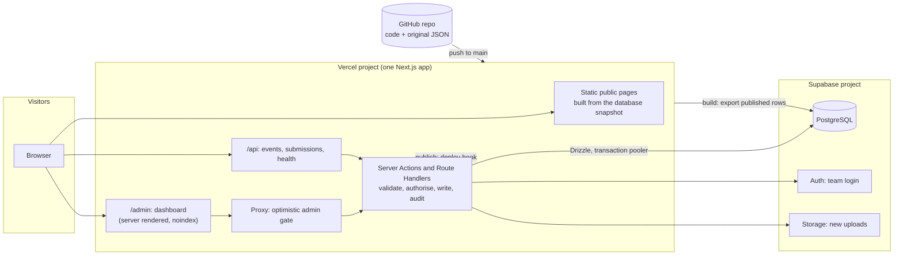

# 1. Architecture

## 1. Starting point (facts from the Phase 1 audit)

- Next.js 16.4.3, React 19, TypeScript, Tailwind 4. `output: "export"`, `basePath: "/aitoolpicks"`, `trailingSlash: true`, unoptimised images, deployed to GitHub Pages by `.github/workflows/deploy.yml` on every push to `main`.
- 30 page routes produce 320 static pages. Every dynamic route sets `dynamicParams = false`.
- Data: `content/tools/*.json` (69), `categories.json` (15 plus 36 subcategories), `articles.json` and 30 HTML bodies, `reviews-extra.json` (12), `models.json`, `affiliate.json`, `logos.json`, `tool-images.json`, `news-images.json`. News (17), best-of guides (6), comparisons (2) and 5 reviews are **TypeScript files**, not JSON.
- `prebuild` runs `scripts/build-catalog.mjs`, which validates the records and writes `src/data/generated/*.json`. Pages and 9 client components import that data synchronously.
- Next.js 16.4.3's own static-export guide lists what a static export cannot do: cookies, Route Handlers that read the request, Server Actions, rewrites, redirects, headers, Proxy and ISR. A login, an API, rate limiting and permission checks all need those.

## 2. Options considered

| | Option | Verdict |
| --- | --- | --- |
| A | Keep GitHub Pages for the public site; run the database and admin as a separate app that triggers rebuilds | Lowest risk but two deployments, two domains, and the public form and analytics endpoints still need a server. Rejected for complexity. |
| **B** | **One Next.js app on Vercel**: public pages statically generated from the database at build time, admin and API as server code in the same project | **Recommended and approved in principle.** |
| C | Self-hosted server (a virtual machine we would run ourselves) | More operating work (patching, TLS, backups, scaling) for no benefit at this size. Rejected. |
| D | Cloudflare (OpenNext) with another Postgres | Less vendor lock-in, but Next 16 support is less turnkey and the stack changes more. Kept as a fallback if Vercel's terms or prices become a problem. |

Vendor lock-in is limited on purpose: the database is plain PostgreSQL accessed through Drizzle (portable to any Postgres host), roles and permissions live in our own tables, and the only Supabase-specific pieces are Auth and Storage, each behind a small interface.

## 3. Final architecture (Option B)



### Principles
1. **The public site stays static.** At build time a script reads only `published` rows from PostgreSQL and writes the same `src/data/generated/*.json` files the pages use today (plus new ones for news, reviews, roundups and comparisons). The existing pages and client components keep working with almost no change. If the database is down or a Supabase free project is paused, the public site keeps serving.
2. **Admin and API are the only server code.** `/admin/**`, `/api/**` and Server Actions run as serverless functions.
3. **The database is the source of truth after migration.** The original JSON files stay in the repository untouched (decision D-02). A `CONTENT_SOURCE=json|db` switch lets the build read either one, which is also the rollback path.
4. **All database access is server-side.** The browser never gets a database credential or the service-role key.
5. **Every sensitive action is checked on the server**, never only by hiding a button.

## 4. Publish flow

1. An editor changes a draft in `/admin` (Server Action: validate with Zod, check permission, write, add an audit row, save a revision).
2. "Preview" renders the draft with the same public components on an admin-only route.
3. "Publish" changes `status` to `published` and sets `published_at`. Sensitive changes need a second person (decision D-06).
4. The action calls the Vercel **deploy hook**. Our own code coalesces calls (it stores the time of the last trigger in `site_settings` and skips a new trigger within 60 seconds while a build is pending), so several quick publishes cause one build.
5. The build exports published rows, runs the catalog validators and the tests, and deploys. A failed build never replaces the live site; the previous deployment keeps serving.
6. The dashboard shows "N unpublished changes" (rows changed after the last snapshot) and the last published time.

Latency: a build plus deploy, expected to be a few minutes (a local production build takes on the order of a minute or two; the time on Vercel has **not been measured**). On-demand ISR (seconds) is possible later but would need the client-side catalog index to move to a fetched asset; not needed for launch.

## 5. Rendering per route

| Route | Today | After |
| --- | --- | --- |
| `/`, `/tools/`, `/tools/[slug]/`, `/tools/[slug]/alternatives/`, `/tools/category/[category]/`, `/compare/`, `/compare/[slug]/`, `/pricing/`, `/reviews/`, `/reviews/[slug]/`, `/blog/`, `/blog/[slug]/`, `/blog/topic/[topic]/`, `/news/`, `/news/[slug]/`, `/best/`, `/best/[slug]/`, `/ecosystem/`, `/ecosystem/companies/[slug]/`, `/verification/`, `/methodology/`, legal pages, `/about/`, `/contact/`, `/credits/`, `/submit/`, `/favorites/`, `/recent/` | Static | **Static**, generated from the snapshot. `dynamicParams` stays `false`; a new tool appears after the rebuild. |
| `/sitemap.xml`, `/robots.txt`, `/manifest.webmanifest`, `/news/feed.xml` | `force-static` | Static from the snapshot. `robots.txt` also disallows `/admin/` and `/api/`. |
| `/admin/**` | does not exist | **Dynamic**, no caching, `noindex`, behind Proxy plus server checks |
| `/api/events`, `/api/submissions` | do not exist | **Dynamic** Route Handlers (public, validated and rate limited) |
| `/api/health` | does not exist | Dynamic; liveness (no database). `/api/health/db` needs a secret header. |
| Legacy `*.html` addresses (32 pages) | meta-refresh stub pages written by `scripts/legacy-redirects.mjs` | Real permanent redirects in `next.config` |

## 6. Configuration changes (all deferred to Phase 8)

| File or setting | Change |
| --- | --- |
| `next.config.mjs` | Remove `output: "export"` and `basePath`; keep `trailingSlash: true`; add `redirects()` generated from the `redirects` table; keep `images.unoptimized: true` (avoids image-transformation usage). |
| `src/lib/site.ts` | `SITE.url` from `NEXT_PUBLIC_SITE_URL`; `withBase()` becomes an identity function (kept so no component needs editing). |
| `scripts/legacy-redirects.mjs` | Retired in favour of `redirects()`. |
| `.github/workflows/deploy.yml` | Stops publishing to Pages after cutover; instead runs typecheck, lint and tests on pull requests. |
| `package.json` | New `db:*` and `snapshot` scripts; new dependencies only after approval. |
| `src/proxy.ts` (new) | Matcher limited to `/admin/:path*`; optimistic session check only. Real authorisation happens in the data access layer. |

## 7. Code structure (proposed, additive)

```
src/server/            server-only (imports "server-only")
  env.ts               Zod-validated environment, fails fast
  db/                  client, schema/*.ts (Drizzle), migrations in /drizzle
  auth/                session, current member, permission checks
  content/             repository functions (one per entity), snapshot export
  stats/               the one statistics service
  audit.ts             audit log writer
  rate-limit.ts
src/app/admin/         dashboard routes, forms, tables
src/app/api/           events, submissions, health
scripts/snapshot.mjs   database to generated JSON (same shape as today)
scripts/migrate/       import, verify, rollback
```
Existing `src/data/*`, `src/lib/*` and components stay in place. A `ContentSource` interface with a JSON adapter (today's behaviour) and a database adapter lets both run side by side and be compared before anything switches.

## 8. Environment variables

| Name | Used by | Public? |
| --- | --- | --- |
| `DATABASE_URL` (transaction pooler, port 6543) | runtime queries | no |
| `DATABASE_DIRECT_URL` (session pooler, port 5432) | migrations, import, backups | no |
| `SUPABASE_URL`, `SUPABASE_ANON_KEY` | Auth client | URL and anon key are designed to be public |
| `SUPABASE_SERVICE_ROLE_KEY` | invitations, Storage uploads | **never public**, server-only |
| `NEXT_PUBLIC_SITE_URL` | canonical links, sitemap | yes |
| `CONTENT_SOURCE` (`json` or `db`) | build | no |
| `DEPLOY_HOOK_URL` | publish | no |
| `ANALYTICS_ENABLED` (default `false`), `ANALYTICS_SALT` | events | no |
| `CRON_SECRET`, `HEALTH_SECRET` | scheduled jobs, deep health check | no |
| `SENTRY_DSN` (optional) | error reporting | the DSN is public by design |

`src/server/env.ts` validates all of them at start-up with Zod and refuses to run with a missing or malformed value. Files named `.env*` are already git-ignored.

## 9. Errors, logging, monitoring, health

- **Errors:** Server Actions return typed results (never raw database errors to the browser); unexpected errors are logged with a request id and shown as a generic message. Admin routes have an `error.tsx` boundary.
- **Logs:** structured JSON lines (level, request id, member id, action). Vercel keeps runtime logs on all plans; the retention period was not stated on the page I read, so it is **unverified**; long-term history comes from our own `audit_logs` table.
- **Monitoring:** optional Sentry (free plan: 5k errors, 1 user, 30-day look-back) wired through one helper so it can be removed.
- **Health checks:** `/api/health` (application up) and `/api/health/db` (`select 1`, secret header). An uptime monitor can poll the first; the second is for the dashboard's "System health" card.
- **Backups and recovery:** see [04-migration-and-hosting.md](04-migration-and-hosting.md#6-backup-and-recovery).
