# 2. Database design (PostgreSQL, Drizzle ORM)

Design only. No migration has been created. Sizes come from the Phase 1 data inventory, so the whole dataset is about 1 MB of JSON; indexing is for correctness and admin filtering, not for scale.

## 1. Conventions

- Tables and columns: `snake_case`; table names plural; foreign keys `<table_singular>_id`; booleans `is_*` or `has_*`; timestamps `*_at` (`timestamptz`, UTC).
- Primary key: `id bigint generated always as identity`. Public content tables also have an immutable, unique, lowercase `slug` that **equals today's id** (for example `chatgpt`), so every URL and every key in `affiliate.json` carries over. A renamed slug is recorded in `redirects`.
- Every content table: `created_at`, `updated_at` (trigger), `created_by`, `updated_by` (team member ids).
- Content lifecycle: `status` enum `draft | in_review | published | archived`, plus `deleted_at` for **soft delete**. Only `published` rows with `deleted_at is null` reach the public snapshot. Hard delete is limited to OWNER, to rows that were never published, and is audit-logged.
- Flexible blocks (a tool's `profile`, review `testing` arrays) are `jsonb` validated by a Zod schema on every write; fields that are filtered, joined or counted are real columns.
- Foreign keys are `on delete restrict` for content relationships (nothing disappears by accident); `on delete cascade` only for pure child rows (plans, sources, evidence).
- Migrations: Drizzle Kit, one folder `drizzle/`, committed, applied with the direct (session-pooler) connection, never edited after merge. Every migration is reversible by a written down-step or a restore point.

## 2. Entity relationship diagram

```mermaid
erDiagram
  companies ||--o{ tools : makes
  categories ||--o{ categories : "parent of"
  categories ||--o{ tool_categories : has
  tools ||--o{ tool_categories : in
  tools ||--o{ pricing_plans : offers
  tools ||--o{ tool_sources : "cites"
  tools ||--o{ verification_checks : "checked by"
  tools ||--o{ tool_alternatives : "alternative to"
  tools ||--o{ reviews : "reviewed in"
  reviews ||--o| review_testing : "hands-on record"
  reviews ||--o{ review_evidence : "supported by"
  review_evidence }o--o| media_assets : screenshot
  authors ||--o{ blog_posts : writes
  blog_posts ||--o{ blog_post_tools : mentions
  tools ||--o{ blog_post_tools : "mentioned in"
  blog_posts ||--o{ comparisons : "is article of"
  news_sources ||--o{ news_items : publishes
  news_items ||--o{ news_tools : concerns
  tools ||--o{ news_tools : "in news"
  roundups ||--o{ roundup_picks : picks
  tools ||--o{ roundup_picks : "picked in"
  models ||--o{ model_tools : "supported by"
  tools ||--o{ model_tools : supports
  companies ||--o{ models : releases
  affiliate_programs ||--o{ affiliate_applications : "applied to"
  affiliate_programs ||--o{ affiliate_links : provides
  tools ||--o| affiliate_programs : "promoted via"
  tool_submissions ||--o{ submission_decisions : "decided by"
  tool_submissions }o--o| tools : "became"
  team_members }o--|| roles : holds
  roles ||--o{ role_permissions : grants
  permissions ||--o{ role_permissions : in
  team_members ||--o{ audit_logs : acts
  team_members ||--o{ content_revisions : edits
  media_assets }o--o| tools : "logo or image of"
  tools ||--o{ analytics_events : "viewed or clicked"
  site_settings }o--|| team_members : "updated by"
```

## 3. Tables

Legend: **PK** primary key, **UQ** unique, **FK** foreign key, **IX** index. `*` = column present on every content table (see conventions).

### 3.1 Catalogue

| Table | Key columns and constraints | Indexes |
| --- | --- | --- |
| `companies` | `id` PK; `slug` UQ; `name` UQ (case-insensitive); `website`; `*` | `slug`, `lower(name)` |
| `categories` | `id` PK; `slug` UQ; `parent_id` FK to `categories` (null = top level; max depth 2 enforced by check); `label`, `short_label`, `blurb`, `cover` enum (chip, board, neural, lens, rack, wafer, fibre, signal), `sort_order`, `is_visible`; `*` | `parent_id`, `(is_visible, sort_order)` |
| `tools` | `id` PK; `slug` UQ; `name`; `company_id` FK; `primary_category_id` FK; `tagline`, `description`; `website_url`; `hue smallint`; `platforms text[]`; `open_source` enum or null; `key_feature`; `aliases text[]`; `logo_site`; `is_featured`; **pricing summary**: `pricing_status` enum (verified, partial, unverified), `pricing_model` enum (free, freemium, free-trial, paid, usage-based, contact-sales, open-source, unknown), `pricing_checked_at date`, `pricing_source_url`, `pricing_regional_note`, `pricing_free jsonb`, `pricing_api jsonb`, `pricing_trial jsonb`, `pricing_reference jsonb`, `pricing_notes text[]`; **verification summary**: `verification_status` enum, `verified_at date`, `official_url`, `pricing_url`, `verification_method`, `verification_notes`; `profile jsonb`; `features text[]`, `use_cases text[]`, `audience text[]`, `strengths text[]`, `limitations text[]`; `added_on date`; `*` | `slug`, `(status, deleted_at)`, `company_id`, `primary_category_id`, `(pricing_status)`, `(verification_status)`, GIN on `aliases` |
| `tool_categories` | `(tool_id, category_id)` PK; both FK; `is_primary boolean`; unique partial index so each tool has exactly one primary | `category_id` |
| `tool_alternatives` | `(tool_id, alternative_tool_id)` PK; both FK; check `tool_id <> alternative_tool_id`; `sort_order` | `alternative_tool_id` |
| `pricing_plans` | `id` PK; `tool_id` FK cascade; `position`; `name`; `audience` enum (individual, team, business, enterprise, api); `currency` char(3); `unit`; `monthly numeric(12,2)`; `annual numeric(12,2)`; `annual_total numeric(12,2)`; `billing`; `is_custom boolean`; `highlights text[]`; `limits text[]`; `note`; unique `(tool_id, position)` | `tool_id` |
| `tool_sources` | `id` PK; `tool_id` FK cascade; `label`; `url`; `type` enum (pricing, docs, official, other); `checked_at date`; unique `(tool_id, url)` | `tool_id` |
| `verification_checks` | `id` PK; `tool_id` FK; `checked_at`; `status` enum; `method`; `notes`; `automated boolean`; `checked_by` FK (null when automated). **Automated checks never change `tools.verification_status`**; only a human action does. | `(tool_id, checked_at desc)` |

`tools.pricing_*` and `verification_*` columns are the latest human-approved state (what the site shows today); `verification_checks` is the history. Plan numeric columns keep today's values exactly; `monthly` and `annual` stay separate because the pages treat them differently.

### 3.2 Reviews

| Table | Key columns and constraints | Indexes |
| --- | --- | --- |
| `reviews` | `id` PK; `slug` UQ; `tool_id` FK; `title`, `summary`, `best_for`, `skip_if`, `pricing_note`, `verdict`; `use_cases text[]`, `pros text[]`, `cons text[]`; `method` enum **`documentation` or `hands-on`, not null**; `reviewer_member_id` FK or `reviewer_name`; `facts_checked_at date`; `*`. Check constraint: `method = 'hands-on'` requires a `review_testing` row (enforced by a deferred trigger and by the Zod schema that today's `trustProblems()` rules become). | `slug`, `tool_id`, `(status, method)` |
| `review_testing` | `review_id` PK and FK cascade (one-to-one); `tested_by`, `role`, `plan`, `region`, `tested_from date`, `tested_to date` (real calendar dates, `tested_to >= tested_from`, not in the future, by check); `hours numeric`; `tasks jsonb`; `worked text[]`; `failed text[]`; `not_reproduced text[]`; `conflicts text` not null | none needed |
| `review_evidence` | `id` PK; `review_id` FK cascade; `label` not null; `url text` (https-only check); `media_asset_id` FK (screenshots); `caption`, `alt_text`; check `url is not null or media_asset_id is not null`. The rule "at least one https URL per hands-on review" is enforced in the application layer and in the publish check. | `review_id` |

A documentation review simply has no `review_testing` row and no evidence requirement, matching `src/lib/review-trust.ts`. No table or column holds a score or rating, so none can be shown.

### 3.3 Blog, authors, comparisons, news

| Table | Key columns and constraints | Indexes |
| --- | --- | --- |
| `authors` | `id` PK; `slug` UQ; `name`; `bio`; `team_member_id` FK (nullable); default author "AI Tool Picks editors" | `slug` |
| `blog_posts` | `id` PK; `slug` UQ; `kind` enum (guide, comparison); `topic` enum (13 values from `topics.ts`); `title`, `description`, `blurb`, `icon`, `cat`; `body_html text` (sanitised, see D-13); `author_id` FK; `featured_media_id` FK; `seo_title`, `seo_description`, `canonical_override`; `published_at`; `*` | `slug`, `(status, published_at desc)`, `topic` |
| `blog_post_tools` | `(post_id, tool_id)` PK; both FK | `tool_id` |
| `comparisons` | `id` PK; `slug` UQ; `blog_post_id` FK (the article); `left_label`, `right_label`; `left_tool_id`, `right_tool_id` FK (nullable); `rows jsonb` (label, left, right, optional price reference) | `slug` |
| `news_sources` | `id` PK; `name` UQ (for example "Google (The Keyword)"); `website`; `is_official boolean` | `lower(name)` |
| `news_items` | `id` PK; `slug` UQ (immutable); `kind` enum (7 values), `tag` enum (6 values), `importance smallint check 1..3`; `title`; `published_on date` (the source's own date); `date_from_url boolean`; `source_id` FK; `source_url` UQ (https); `summary`; `matters`; `same_story_as_id` FK to `news_items` (null normally); `source_verified_at date`, `source_verified_by` FK; `image jsonb`; `*` | `slug`, `(status, published_on desc)`, `source_id` |
| `news_tools` | `(news_item_id, tool_id)` PK; both FK | `tool_id` |

### 3.4 Roundups and models (needed to keep today's pages)

| Table | Key columns | Notes |
| --- | --- | --- |
| `roundups` | `id` PK; `slug` UQ; `title`, `description`, `category_id` FK, `intro text[]`, `criteria text[]`, `note`; `*` | 6 rows today |
| `roundup_picks` | `(roundup_id, tool_id)` PK; `badge`; `why`; `position` | 29 rows today |
| `models` | `id` PK; `slug` UQ; `name`; `company_id` FK; `released date`; `summary`; `licence`; `tool_note`; `details text[]`; `sources jsonb`; `*` | 9 rows today |
| `model_tools` | `(model_id, tool_id)` PK | |

### 3.5 Affiliate

| Table | Key columns and constraints |
| --- | --- |
| `affiliate_programs` | `id` PK; `tool_id` FK UQ (one programme per tool, as in `affiliate.json`); `status` enum **`approved | pending | unavailable | ordinary`**; `network`; `apply_url` (https); `terms_url`; `source_url`; `checked_at date`; `note`; `disclosure_text`; `official_url` (the tool's own site, for the non-affiliate button) |
| `affiliate_applications` | `id` PK; `program_id` FK; `status` enum (draft, submitted, approved, rejected, withdrawn); `submitted_at`, `decided_at`; `applied_by` FK; `notes`. History of what happened; `affiliate_programs.status` is derived from the latest decision by a human action. |
| `affiliate_links` | `id` PK; `program_id` FK; `country_code char(2)` or `'default'`; `url` (https, check); unique `(program_id, country_code)`. **Check:** a link may exist only while `affiliate_programs.status = 'approved'`, enforced by trigger, mirroring the existing rule "a link is used only when approved". |

The existing click-event behaviour (`aitp:outbound` event, `data-affiliate-status`) is unchanged; the snapshot writes the same `affiliate.json` shape.

### 3.6 Submissions

| Table | Key columns and constraints |
| --- | --- |
| `tool_submissions` | `id` PK; `public_id uuid` UQ (shown to the submitter); `name`, `website_url`, `website_host` (normalised, indexed), `company`, `category_id` FK, `description`, `features`, `pricing_url`, `submitter_name`, `contact_email` (optional, never public); `status` enum (new, in_review, approved, rejected, duplicate, spam); `duplicate_of_tool_id` FK; `resulting_tool_id` FK; `source` enum (web, github); `ip_hash`, `created_at`. Duplicate detection: unique partial index on `website_host` for non-rejected rows, plus a name check, mirroring `findDuplicate()` (hosts shared by several tools, for example `github.com`, are compared on path as well). |
| `submission_decisions` | `id` PK; `submission_id` FK; `decision` enum; `decided_by` FK; `internal_note`; `created_at`. Notes are internal; the submitter never sees them. |

### 3.7 Team, roles, audit

| Table | Key columns and constraints |
| --- | --- |
| `team_members` | `id` PK; `auth_user_id uuid` UQ (Supabase Auth user); `email` UQ; `display_name`; `role_id` FK; `status` enum (invited, active, disabled); `invited_by`, `invited_at`, `last_seen_at`; `disabled_at` |
| `roles` | `id` PK; `key` UQ (`owner, admin, editor, reviewer, analyst, contributor`); `label`; `is_system boolean` (system roles cannot be deleted) |
| `permissions` | `id` PK; `key` UQ (for example `tools:publish`); `description` |
| `role_permissions` | `(role_id, permission_id)` PK |
| `audit_logs` | `id` PK; `occurred_at`; `actor_member_id` FK (null for system); `action` (for example `tool.publish`); `entity_type`, `entity_id`; `before jsonb`, `after jsonb` (secrets never stored); `request_id`; `ip_hash`. **Append-only**: the application role has `insert` and `select` only; no update or delete. |
| `content_revisions` | (D-14, optional) `id` PK; `entity_type`, `entity_id`; `revision int`; `data jsonb`; `state` enum (draft, submitted, approved, rejected); `created_by`, `approved_by`; unique `(entity_type, entity_id, revision)`; check `approved_by <> created_by` when the two-person rule applies |

### 3.8 Analytics, settings, media, redirects, rate limits

| Table | Key columns |
| --- | --- |
| `analytics_events` | `id` PK; `occurred_at`; `event` enum (page_view, tool_view, directory_search, category_visit, outbound_official, outbound_affiliate, submission_created); `path_group`; `tool_id` FK (nullable); `category_id` FK (nullable); `query_len smallint` (search text is **not stored**); `device_class` enum (mobile, tablet, desktop); `country char(2)`; `visitor_hash` (optional, see doc 06). Partitioned by month only if volume ever requires it. Raw rows kept 90 days. |
| `analytics_daily` | `(day, event, tool_id, category_id, path_group)` PK; `count int`. Written by the nightly rollup. |
| `site_settings` | `key` PK; `value jsonb`; `updated_at`; `updated_by`. Keys: contact details, SEO defaults, analytics switch, publish-hook state. |
| `media_assets` | `id` PK; `storage` enum (`repo`, `supabase`); `path`; `mime`; `bytes`; `width`, `height`; `sha256`; `alt_text`; `credit`; `source_url`; `kind` enum (logo, tool_image, news_image, article_image, screenshot, cover, brand); `tool_id` FK (nullable); `*`. Imported from `logos.json`, `tool-images.json`, `news-images.json` with their existing metadata. |
| `redirects` | `id` PK; `from_path` UQ; `to_path`; `status_code` (301 or 308); `reason`; `created_at`. Holds renamed slugs and the 32 legacy `.html` addresses. |
| `rate_limit_hits` | `(key_hash, route, window_start)` PK; `count int`. Short-lived; pruned every hour. |

## 4. Tables beyond your list, and why

| Added | Reason |
| --- | --- |
| `companies` | Today `vendor` is free text (65 values); company pages and the ecosystem map group by it. |
| `tool_alternatives`, `tool_sources`, `verification_checks`, `blog_post_tools`, `news_tools`, `tool_categories` | Join tables or history required by the relationships already in the data. |
| `comparisons`, `roundups`, `roundup_picks`, `models`, `model_tools` | Existing public features whose data is currently TypeScript. |
| `redirects` | Replaces the 32 stub pages and records renamed slugs. |
| `rate_limit_hits` | Per-account rate limiting that Vercel's IP-keyed rule cannot do. |
| `content_revisions` | Optional (D-14). |
| `analytics_daily` | Aggregation so reports stay fast and raw events can expire. |

## 5. Mapping from the current data

| Source today | Goes to | Notes |
| --- | --- | --- |
| `content/tools/<id>.json` top-level fields | `tools` | `id` becomes `slug`; `vendor` becomes a `companies` row; `category` and `categories` become `tool_categories`; `alternatives` become `tool_alternatives`. |
| `pricing.plans[]` (288) | `pricing_plans` | Order preserved in `position`. |
| `sources[]` (139) | `tool_sources` | |
| `verification` and `pricing.checked` | `tools.verification_*` plus a first `verification_checks` row | History starts at the import. |
| `profile` (69) | `tools.profile jsonb` | Validated by the existing `catalog-lib.mjs` rules ported to Zod. |
| `content/categories.json` | `categories` (15 top-level plus 36 children) | |
| `content/articles.json` and `content/articles/*.html` (30) | `blog_posts`; the 2 comparison articles also get a `comparisons` row from `compare.ts` | The `data-aff` and `data-price` attributes inside the HTML are kept (the sanitiser allow-list includes them). |
| `content/reviews-extra.json` (12) and the 5 inline reviews in `reviews.ts` | `reviews` | All 17 get `method = 'documentation'`, no `review_testing`. None becomes hands-on. |
| `src/data/news.ts` (17) and `content/news-images.json` | `news_items`, `news_sources`, `news_tools` | `sameStoryAs` becomes `same_story_as_id`. |
| `src/data/roundups.ts` (6, 29 picks) | `roundups`, `roundup_picks` | |
| `content/models.json` (9) | `models`, `model_tools` | |
| `content/affiliate.json` (15) | `affiliate_programs` (status and notes); `affiliate_links` stays empty | Nothing is approved today, so no link row exists. |
| `content/logos.json` (69), `tool-images.json` (63), `news-images.json` (6), `public/` (351 files) | `media_assets` with `storage = 'repo'` | Files do not move (D-04). |
| 32 legacy `.html` pages | `redirects` | |
| `SITE.updated` constant | `site_settings` (derived from the latest published change) | |

## 6. Integrity rules enforced in the database

- Unique slugs on every public table; case-insensitive unique company and category names.
- Exactly one primary category per tool; no tool listed as its own alternative.
- A hands-on review needs testing data; testing dates are real, ordered, and not in the future; conflicts text is mandatory.
- Affiliate links only for approved programmes; links must be `https`.
- Published rows must have their required fields (checked by a publish function, not only the form).
- Audit rows cannot be changed or deleted by the application role.
- Row Level Security is enabled on every table with no public policy (see doc 03).
